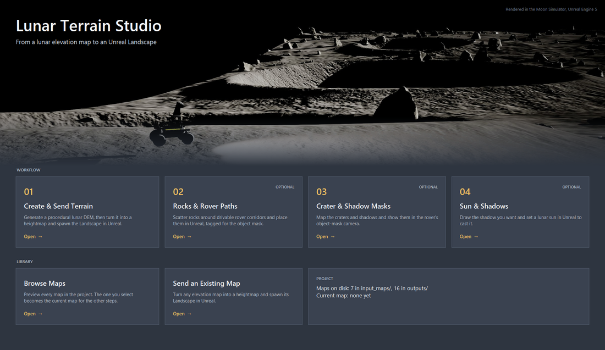
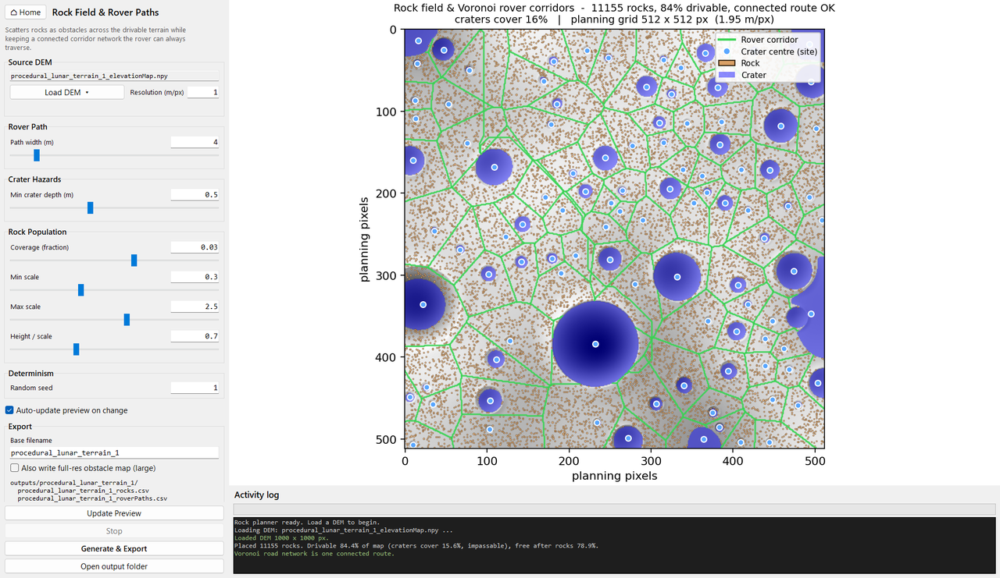
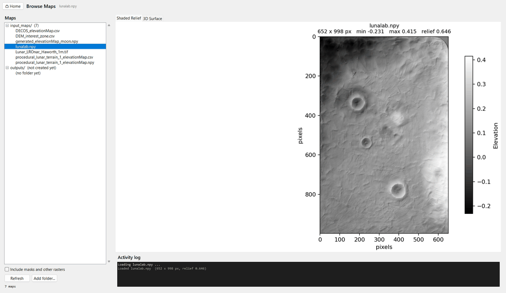

# Unreal Moon Terrain Generation

Generate procedural lunar elevation maps (DEMs), place rocks with guaranteed rover
corridors, and import the result into Unreal Engine as a scaled Landscape.

<p align="center"></p>

## Quick start

```sh
run_terrain_studio.bat                 # Windows
./run_terrain_studio.sh                # Linux / macOS (chmod +x once)
python Terrain_Studio/terrain_studio.py  # any platform
```

Install the dependencies once (pinned in `requirements.txt`: numpy, scipy,
scikit-image, pandas, PyYAML, matplotlib, Pillow, and tifffile for GeoTIFF input):

```sh
py -m pip install -r requirements.txt        # Windows
python3 -m pip install -r requirements.txt   # Linux / macOS
```

Tkinter ships with Python (`sudo apt install python3-tk` on Debian/Ubuntu).

The home screen lays out the four workflow steps in order: create and send a
terrain, place rocks, mask craters, position the sun. A library holds the map
browser and a standalone sender.
Every view opens in the same window and has a **⌂ Home** button to return.

In every view, the left column is split into tabs, one per step: for
example, the rock planner has **Plan | Export & Unreal**. Each tab holds that
step's settings, with its buttons pinned underneath. The map the view works on
stays above the tabs. **Stop**, which ends whatever job is running, is next to
the activity log.

In the rock planner, **Place Rocks in Unreal** places the rock field that
**Generate & Export** last wrote. Each export saves the settings it was made
with (`<map>_rocks_settings.json`). A line above the buttons says whether the
file still matches the controls or lists what changed. If you press Place
with an out-of-date export, or none, the studio offers **Export, then Place**.

## 1. Create a terrain and send it to Unreal


- **Parameters** (left), in tabs: **Terrain** (preview, map geometry, relief,
  seed), **Craters**, **Display** (colormap and shading), **Export** (Generate
  Full Resolution) and **Unreal** (Send to Unreal). Every setting is a slider
  with a typed entry and a tooltip. Presets are the YAML files in `config/`,
  shared with the CLI.
- **Preview** (centre): shaded relief, 3D surface and slope analysis, updated as
  you drag. A fixed seed reproduces a surface; a blank seed rolls a new one.

  
- **Readouts** (right): surface statistics and the resulting Unreal Landscape
  topology, which warns if the map exceeds a single Landscape's 50×50 components.
- **Generate Full Resolution** writes the DEM to `outputs/<name>/`; the panel
  lists the exact filenames before you run. It also writes `<name>_craters.csv`,
  every crater it placed (`id, row, col, radius_px, x_m, y_m, radius_m, depth_m,
  rim_height_m, ejecta_radius_m`), which step 3 uses as exact crater ground truth.
  With CSV export, `<name>_elevationMap.csv` and `<name>_soilMap.csv` (interior
  1, border 0) are the maps the GNC path planner reads: copy them to
  `GNC-Moon-Simulator/component_path_planner/maps/` and name them in its
  `config/params.yaml`.

Column widths are adjustable with the drag handles.

**Send to Unreal**, on the **Unreal** tab, takes the generated map (or any other
you pick):

Converts an elevation map to Unreal's 16-bit `.r16` heightmap, spawns the
Landscape actor in a running editor, applies the heightmap to it and saves the
level. The heightmap is written to `outputs/<name>/`. Untick *Dispatch to
running Unreal Editor* to only write the files (a dialog then gives the path and
the manual import steps), or *Save the level afterwards* to leave saving to you.

Every new Landscape is set up for the simulator:

- it gets the project's `/Game/Landscape/Landscape_Material`;
- it is tagged for the rover's object mask (Render CustomDepth on, stencil 5,
  `landscape`; see [Object mask ids](#object-mask-ids)).

If that material is missing, a warning is logged and the engine's default
material stays. Both defaults are at the top of `unreal_landscape.py`.

**Unreal setup:** enable the *Python Editor Script Plugin* and *Remote Execution*
in Project Settings. Landscapes larger than 4097 × 4097 vertices, or an
automatic import that fails, fall back to the manual import (Landscape Mode →
Manage → right-click → Import), with the steps shown in the editor.

## 2. Place rocks and rover paths (optional)



Scatters rocks across the drivable ground while guaranteeing a connected route:

1. **Craters** — closed depressions deeper than a threshold, found by
   priority-flood sink filling — are impassable. Rocks also stay out of every
   crater bowl up to its rim crest (plus one planning cell), using the same
   crater circles as the crater map (step 3), so no rock lands on a crater id.
   The circles are fitted on a grid of up to 1024 px, so small craters are kept
   clear too.

   **Presets** (Plan tab, `config/rocks/*.yaml`; **Save as…** adds your own).
   Each file explains its values:

   | Preset | Coverage | Rock radius | Rocks per km² | Time to place in Unreal |
   |---|---|---|---|---|
   | `lunar_mare` (default) | 0.6% | 0.2–2.0 m | ~11,000 | ~3 min |
   | `lunar_highlands` | 1.5% | 0.2–2.5 m | ~27,000 | ~7 min |
   | `blocky_ejecta` | 4% | 0.2–3.0 m | ~69,000 | ~17 min |
   | `quick_test` | 0.1% | 0.3–2.0 m | ~900 | seconds |

   The mare coverage follows LRO Diviner's rock abundance: about 0.4–0.5% of
   the Moon's surface is covered by rocks of about 1 m or larger (Bandfield et
   al., 2011), scaled to the smaller rocks counted here. The minimum radius,
   0.2 m (0.14 m tall), matches the GNC planner's 0.15 m obstacle height.

   Each preset also sets `BOULDER_MIN_RADIUS_M`, the object-mask split when
   placing: rocks at least this radius are `boulder` (id 9), smaller ones
   `small_rock` (id 10). It is 0.5 m (rocks of 1 m and up, the size Diviner
   counts), which tags about 10% of a lunar_mare field as boulders. It is the
   **Boulder if radius ≥** field on the Export & Unreal tab; changing it does not
   require a new export.

   For a map generated in step 1, **Crater Hazards → Exact, from the generator**
   (chosen automatically when `<map>_craters.csv` is next to the DEM) uses the
   generator's own crater list instead of detecting craters. The craters at
   least *Min crater depth* deep are impassable and are the corridors' sites.
   Every crater's bowl, up to its rim, is kept free of rocks. Detection can
   miss craters: on a 1000 × 1000 map with 400 craters it found 186, and the
   plan put 409 rocks inside real crater rims, against 0 with the exact list.
2. **Corridors** follow the Voronoi diagram of the crater centres, so the rover
   drives down the middle of the gaps between them.
3. **Rocks** are never placed within half the path width of a corridor.

Planning runs on a grid capped at 512 px and is scaled back to metres. Loading a
DEM names the export after it, so the files land beside that map:

| File | Contents |
| --- | --- |
| `<name>_rocks.csv` | One row per rock: `id, row, col, x_m, y_m, scale, height_m` |
| `<name>_roverPaths.csv` | Corridor polylines: `path_id, x_m, y_m` |
| `<name>_obstacleMap.csv` | Optional 0/1 rock-footprint raster at full DEM resolution |

`x_m` and `y_m` are metres east and north of the map corner (no Z — take it from
the DEM). `scale` is the uniform mesh scale, i.e. the radius in metres of a 1 m
base mesh; `height_m` is `scale × ROCK_HEIGHT_RATIO`.

**Place Rocks in Unreal** puts the exported rocks on the Landscape and tags each one
for the rover's object mask (`navcam/central/object_mask`) as a boulder or a small
rock. The tags are the *Object mask ids*: by default 9 for boulders and 10 for
small rocks, split at a 0.15 m radius. **Update Mask Ids Only** re-tags rocks
already placed without moving them.

A field is placed as one actor, `<name>_rocks`, with one instanced static mesh
component per rock model and mask id, instead of one actor per rock. Every view
in Unreal (the editor and each rover camera and sensor) handles actors one by
one, so ten thousand rock actors limited the frame rate: converting a 10,338-rock
field raised Play from 14 to 20 frames/s with every camera streaming. Instances
keep their own position, rotation, scale and collision. Rocks placed with
physics simulation stay one actor each. A field placed by an earlier version
can be converted in place, keeping every rock where it is:
`send_rocks.send_instance_to_unreal("<name>")` from `Terrain_Studio/unreal_link`.

## 3. Crater and shadow masks (optional)

Shows craters and shadows in the rover's object mask, alongside the rocks:

1. **Find Craters** maps them on the DEM and shows them on the map preview.
2. **Mask Camera in Unreal** picks the scene capture that renders the mask. The
   list is read from the open level, and the default is the rover's
   `Navcam_Mask`.
3. **Send Masks to Unreal** does three things:
   - exports the crater map;
   - rebuilds `PPM_GroundTruthMask` so the Landscape shows the craters and, with
     *Stream a shadow mask feed*, the frame also carries the shadows and, with
     *Tag the rover's shadow separately*, the rover's own shadow
     ([Rover shadow](#rover-shadow));
   - sets up the chosen camera: it gets `PPM_GroundTruthMask` and the sun-only render
     shadows need, and, if its actor has an UnrealStereoCam, it becomes the
     streamed mask camera (of the navcam rig's UnrealStereoCam, when the actor
     has several).

   The rover's rear camera has a mask capture of its own, `RearCam_Mask`,
   streamed by `RearCam_Stream` (see the GNC simulator's UnrealStereoCam
   README). It uses the same `PPM_GroundTruthMask`, so every send updates it too;
   keep `Navcam_Mask` as the mask camera chosen here.

   **Restore Original Mask Material** undoes the material change.
4. **GNC Labels** shows the object-mask classes with the rock and crater ids
   chosen here, and whether the GNC simulator's copy
   (`GNC-Moon-Simulator/component_stereo_depth/config/mask_classes.json`, read
   when that repository sits next to this one) differs. **Copy** puts a complete
   `mask_classes.json` with these ids on the clipboard, to paste into the GNC
   copy (and into `config/` here to keep changed ids).

Where the craters come from:

- **Terrains generated in the studio** come with `<name>_craters.csv`, and step 3
  uses it by default (*Exact, from the generator*). Centres and radii are the
  ones the generator stamped: the crater is the bowl inside the rim crest, at the
  crater radius, and the generator's ejecta rim reaches 1.5 × the radius (rim
  width 0.5).
- **Other maps** are *Detected in the DEM*, as follows. On generated terrain,
  detection sizes large craters (radius ≥ 10 px) within 3%, but makes small ones
  (5–10 px) about 40% too small. That is the reason to prefer the generator's
  list when there is one.

How detection works:

- It starts from the closed depressions the rock planner treats as impassable.
- Each crater is the circle fitted through its rim crest, so it covers the whole
  bowl even on sloping ground.
- Shallow or elongated basins are rejected.

The crater map is `<name>_craterMask.png` in the map's output folder, with a JSON
beside it. Its pixel values are mask ids:

| Value | Meaning |
| --- | --- |
| `0` | Not a crater |
| `6` | Crater: ground inside the rim crest |
| `7` | Crater rim: a ring outside the crest, 0.2 × the radius wide by default |

The map uses 4 cells per DEM cell (25 cm on a 1 m map), capped at 8192 px.

How the mask is drawn: the mask camera's material looks at each Landscape pixel
(stencil 5), takes the world point it shows, and reads the crater map there. So:

- rocks and the rover keep their own ids;
- craters hidden behind terrain stay hidden;
- everything lives in `/Game/GroundTruth_Masks`, one subfolder per feature:

  | Asset | What it is |
  | --- | --- |
  | `Mask/PPM_GroundTruthMask` | Post-process material on the mask camera: object ids, crater ids on the Landscape, shadow flag bits |
  | `Mask/PPM_GroundTruthMask_Backup` | That material as it was before the studio first changed it; **Restore Original Mask Material** puts it back |
  | `CraterMaps/T_CraterIds_<map>` | Crater map: crater or rim id per cell |
  | `RoverShadow/RT_RoverDepthFromSun` | The rover's shadow map: its depth seen from the sun |
  | `Sun/MPC_Sun` | The sun's direction and disc size, for its id in the object mask |
  | `WheelTracks/M_WheelTrackDecal` | The wheel-track decal material |

  Assets still directly in the folder, or under their earlier names
  (`PPM_ObjectMask`, `PPM_ObjectMask_Original`, `RT_SunWithoutRover`), are moved
  on the next send;
- it also works during Play In Editor, although camera changes made then last
  only until it stops.

GNC receives two feeds from the mask camera, taken from the same frame:

| Topic | Contents |
| --- | --- |
| `navcam/central/object_mask` | Rover, landscape, rocks, craters and rims, without shadows |
| `navcam/central/shadow_mask` | Sunlight only: black in shadow (ground, rocks, rover), orange for the rover's own shadow, blue for sunlit ground, grey for sunlit rocks and the rover, black for sky |
| `navcam/central/shadow_label` | The same classes as ids (mono8), for training; see [Shadow class ids](#shadow-class-ids) |
| `navcam/central/shadow_label_mapping` | JSON legend of those ids |

The dashboard shows both, as SEGMENTATION and SHADOW MASK. Their legends list
each class with its id (object mask id, or `shadow_label` id), grouped into
ground, objects and sky.

### Object mask ids

The object mask's ids are consecutive, and each is drawn in one fixed colour.
They are defined once, in `config/mask_classes.json` (id, name, group, colour),
read by `Terrain_Studio/unreal_link/mask_classes.py` for the mask material's
palette, the actors' stencils, the crater map and the GUI. The GNC simulator
keeps a copy of the same file (`component_stereo_depth/config/mask_classes.json`):
its stereo node publishes the classes and its dashboard draws the legends from
them. Edit both together; the file is read on every action, so an edit applies
without restarting the editor.

| Id | Class | Colour (RGB) | Comes from |
| --- | --- | --- | --- |
| 0 | `unlabeled` | 0, 0, 0 | Anything not tagged |
| 1 | `sky` | 36, 40, 96 | Nothing within 100 km of the camera |
| 2 | `rover` | 250, 194, 16 | The rover's CustomDepth stencil (its Blueprint) |
| 3 | `sun` | 28, 128, 162 | Sky within the sun's disc |
| 4 | `sun_glare` | 230, 14, 118 | Sky around the disc, out to the glare radius |
| 5 | `landscape` | 10, 96, 216 | The Landscape's stencil |
| 6 | `crater` | 124, 50, 208 | The crater map, on the Landscape |
| 7 | `crater_rim` | 86, 52, 82 | The crater map, on the Landscape |
| 8 | `wheel_track` | 64, 124, 162 | Track decals, on the Landscape |
| 9 | `boulder` | 238, 244, 242 | Rock stencil (radius ≥ 0.15 m) |
| 10 | `small_rock` | 210, 62, 6 | Rock stencil (smaller rocks) |

The lowest bit of each channel carries the shadow flags (cleared in
`object_mask`), so the colours are even. A custom stencil above 10 gets a colour
hashed from its id. Sending the masks re-tags a Landscape still on the earlier
stencil (10); rocks placed before keep theirs until **Update Mask Ids Only**.

Shadows are taken from the engine's own rendering, so they match what the cameras
see: the rover's and the rocks' shadows, crater walls, hills and slopes facing
away from the sun.

- The mask camera renders every surface white, lit by the sun alone: no bounce
  light, no sky light, and no headlights or other lights. Its colours are replaced
  by the mask material, so this changes nothing else.
- Any surface this render leaves dark is shadow: ground, the unlit sides of rocks,
  and the parts of rocks or the rover that another object shades.
- A patch lit only by the rover's headlights is still shadow, because only the
  sun counts.

### Shadow threshold

A pixel is shadow when the mask camera's sun-only render shows it at less than
**half of full sunlight** (display value 0.5 of 1).

- Set by `SHADOW_THRESHOLD` in
  `Terrain_Studio/unreal_commands/unreal_ground_truth.py` and written to the
  `ShadowThreshold` parameter of `PPM_GroundTruthMask` on every send. Change it there
  and send the masks again.
- That render is almost all black (shadow) or near white (sunlit). The values in
  between are penumbra: shadow edges and the thin tails of shadows cast by rocks,
  which at a distance cover only part of a pixel.
- Half light counts those tails as shadow and matches what the RGB camera shows.
  A much lower value (for example 0.04) keeps only the solid core of each shadow
  and drops the tails rocks cast onto the terrain.
- Checked with the sun at 3°, 6° and 19° elevation: ground lit at a grazing angle
  stays above the threshold.

### Shadow class ids

`navcam/central/shadow_label` is a mono8 image the size of the mask, aligned
pixel for pixel with `image_color` and `object_mask`. Each pixel holds one id:

| Id | Class | Meaning |
| --- | --- | --- |
| 0 | `sky` | No surface |
| 1 | `sunlit_ground` | Landscape, crater or rim in sunlight |
| 2 | `shadowed_ground` | Landscape, crater or rim without sunlight |
| 3 | `sunlit_object` | Rock or rover in sunlight |
| 4 | `shadowed_object` | Rock or rover without sunlight, including its unlit side |
| 5 | `rover_shadow` | Ground or rock in the rover's own shadow |

- The same legend is published as JSON on `shadow_label_mapping`, and the
  dashboard's rosbag button records both topics.
- Store the labels losslessly (PNG or the bag itself); JPEG would change the ids.
- For finer classes, combine the label with `object_mask` pixel by pixel (for
  example "boulder in shadow" or "crater in shadow").

### Sun

With *Tag the sun's disc in the object mask* (Sun group, on by default), sky
pixels within the sun's disc get id 3 (`sun`) in `object_mask`; the rest of the
sky is id 1 (`sky`).

- The disc follows the level's Directional Light: its direction, and its size from
  *Source Angle* (0.53 degrees, about 4 pixels on the navcam). Terrain or rocks in
  front of the sun hide it, as in the RGB image.
- The navcam's bloom makes the sun look much bigger. So the sky around the disc,
  out to *Glare radius* (Sun group, default 1.1 degrees), gets id 4
  (`sun_glare`). 1.1 degrees matches the
  camera's saturated core: measured 17.2 px across, against 17.4 px for disc plus
  glare, with 91% of the saturated pixels covered. Half brightness reaches about
  3.5 degrees, and faint glare spikes about 6 degrees; set a larger radius to
  include them, or 0 for no glare ring. Like the disc, the glare is only tagged on
  sky; terrain and rocks keep their ids.
- The light's direction reaches the material through `/Game/GroundTruth_Masks/Sun/MPC_Sun`.
  The editor watcher (see Rover shadow) keeps it current, also during Play, so
  moving the sun by hand or from the studio needs no new send.
- The material flags the disc with red but not blue, so the shadow feeds keep it
  as sky (black, `shadow_label` 0).

### Wheel tracks

With *Rover leaves wheel tracks* (Wheel Tracks group, on by default), each wheel of
the mask camera's actor leaves a track on the Landscape during Play: a shallow
rut with tread ribs across it, in packed-down regolith. The decal redraws the
Landscape's own regolith texture at the same place (same tiling, desaturation
and near/far blend as `Landscape_Material`, read from it on each send). The
regolith's surface is matched too, so a track keeps the ground's grain and colour
and blends into it:
  - **Normal:** the Landscape's normal map at both tilings, in the Landscape's own
    frame and on the slope under the track, so the grain is lit as around it,
    pressed to 60% by the wheel, plus the rut and the tread: square lug imprints
    every 3 cm with sloped flanks, which catch the sun like a tyre print.
  - **Roughness:** the Landscape's roughness texture at both tilings, 10% smoother.
  - **Specular:** the Landscape's (0), so tracks do not shine.
  - **Colour:** the lug imprints are 8% darker, so the tread also shows under a high sun.
  - Result: about 9% darker than the ground beside them. Track
pixels get id 8 (`wheel_track`) in `object_mask`.

- **Send Masks to Unreal** places a pool of 2000 hidden track decals in the level
  (Outliner folder `WheelTracks`, material
  `/Game/GroundTruth_Masks/WheelTracks/M_WheelTrackDecal`). The first time takes about
  two minutes; later sends reuse them. Save the level to keep them.
- During Play the editor watcher lays the next decal under each wheel that
  touches the Landscape, every 12 cm along its path. A piece is laid once every
  wheel has rolled off it, so no track lands on a wheel. About 60 m per wheel are
  kept, the oldest reused. Tracks start afresh each time Play starts. No tracks
  are left on rocks or while a wheel is in the air.
- For the first 3 s of Play (`SETTLE_TIME_S` in
  `unreal_runtime/unreal_wheel_tracks.py`) the rover settles onto the ground, and
  its movement is ignored: no tracks are laid. This keeps the settling from
  leaving tracks.
- The rover itself is only read, never changed, while the game runs. Changing a
  simulating part's properties rebuilds its physics and breaks the wheel
  constraints.
- The decal writes a tiny metallic value (0.05) that the regolith never has. The
  mask material reads it to tag the track. It also works on craters and rims.
- **Tread look** (Wheel Tracks group, with a preview):

  | Setting | Choices |
  | --- | --- |
  | Tread pattern | Straight lugs (default), Chevron, Staggered blocks, Smooth (no tread) |
  | Lug spacing | 2, 3 (default), 4 or 6 cm; all divide the 12 cm decal spacing, so the tread stays continuous |
  | Tread relief | 0 (none) to 2 (deep); 1 default |
  | Regolith shade | 0.5 (dark tracks) to 1 (same as the ground); 0.7 default |

  **Apply Track Look** updates only the track material in Unreal (also during
  Play); **Send Masks to Unreal** applies it too.
- Unticking the option and sending again removes the decals.

### Rover shadow

With *Tag the rover's shadow separately* (on by default), ground and rocks in the
rover's own shadow get id 5 (`rover_shadow`) instead of 2 or 4.

- **Send Masks to Unreal** adds a helper capture to the level,
  `<actor>_RoverShadowCapture`: the rover's own shadow map. It renders only the
  rover's depth, looking along the sunlight (orthographic, about 2 m across,
  512 × 512 into `/Game/GroundTruth_Masks/RoverShadow/RT_RoverDepthFromSun`).
- A shadowed pixel is the rover's shadow when the rover lies between it and the
  sun. So the rover's shadow wins over any other shadow on the same ground:
  where it falls on a rock's shadow, a crater wall, a slope facing away from the
  sun or the terrain's own small bumps, it is still `rover_shadow`. The rover
  itself is never tagged: its unlit side stays `shadowed_object`.
- The editor watcher points the shadow map at the rover from the sun every
  frame, in the level and in a running game: centred on the mask camera, which
  rides the rover's body, and following the sun. Its position and axes reach the
  mask material through `MPC_Sun`. The watcher lives in the Unreal project and
  needs neither Terrain Studio nor this repository (see
  [Editor watcher](#editor-watcher)).
- It renders before the mask camera each frame: a depth-only view of the rover,
  much cheaper than a second camera view. Unticking the option and sending
  again removes it, as does **Restore Original Mask Material**.
- Add it in the editor, not during Play: the helper must be in the level, so save
  the level (Ctrl+S) to keep it.
- How it is added: Unreal's Python cannot set a capture's show-only list in the
  editor, so the studio pastes the helper from text with the list already filled
  in, then sets it up. That briefly uses the clipboard; its text is put back
  afterwards (other clipboard content, such as an image, is not).

How the shadows travel: the mask material stores three flags in the lowest bit of
each channel: *ground* in green, *in shadow* in blue and *rover shadow* in red.
That changes the mask colours by at most 1/255. The GNC stereo node
(`enable_shadow_mask` in `component_stereo_depth/config/params.yaml`) paints
`shadow_mask` and `shadow_label` from these flags and clears them from
`object_mask`. One camera therefore gives exactly aligned feeds, with no change
to the UnrealStereoCam plugin.

## 4. Position the sun (optional)

Places the sun so shadows fall where you want them and sets the matching light in
Unreal. The sun is set in one of three ways:

- the azimuth and elevation sliders;
- clicking the sky dome;
- drawing a shadow on the map: click where an object of a given height stands and
  drag to where its shadow should end.

Azimuth is measured clockwise from the top of the DEM image: 0 points to Unreal
−Y and 90 to −X. The Landscape mirrors the DEM, since columns run towards −X, so by
default the map is shown as Unreal's Top view shows it (+X right, +Y down). The
sky dome is labelled with Unreal's axes.

The map shows the terrain lit by that sun, with no sky light, so shadows are black.
Optionally, cast shadows are tinted, which tells them apart from slopes facing away.
A second tab shows a lit 3D view. Shadows are cast from the DEM, which matches the
Landscape: line traces in Unreal agree with them at 97–100% of points, and every
mismatch lies on a shadow edge.

**Send Sun to Unreal** updates the light labelled `LunarSun`, or the level's only
Directional Light, and spawns `LunarSun` if there is neither. It applies lunar
settings:

- white light with no atmospheric reddening;
- a 0.53° sun disc;
- movable, with dynamic shadows reaching at least 200 m;
- intensity set in the panel.

During Play In Editor, only the running game changes; send the sun again after
stopping it to keep it in the level. **Read Sun from Unreal** loads the level's
current sun into the sliders.

## Editor watcher

A small Python function runs inside the Unreal Editor on every frame. It:

- points the rover's shadow map at the rover from the sun, every frame;
- keeps `MPC_Sun` pointing at the sun (sun id in the object mask);
- during Play, lays the wheel tracks.

It only reads the rover and moves its own objects. It is editor Python, so it
works in the editor and Play In Editor, not in a packaged game.

**Where it lives:** in the Unreal project, independent of Terrain Studio:

| File | Role |
| --- | --- |
| `<Project>/Content/Python/init_unreal.py` | Unreal runs it when the editor opens; it starts the watcher |
| `<Project>/Content/Python/TerrainStudio/*.py` | The watcher's modules: `unreal_watcher`, `unreal_wheel_tracks` |

**Sources in this repository:** the watcher and the studio are kept apart.

| Folder | Files | Role |
| --- | --- | --- |
| `Terrain_Studio/unreal_runtime/` | `init_unreal.py`, `unreal_watcher.py`, `unreal_wheel_tracks.py` | Only the watcher's per-frame work. Copied into the project; imports nothing from the studio |
| `Terrain_Studio/unreal_commands/` | `unreal_ground_truth.py`, `unreal_track_setup.py`, ... | The studio's Unreal-side commands, run when it sends: mask material, cameras, rover-shadow helper, track decals and material. Uses the watcher's helpers and constants, never the other way round |

**Kept up to date:** every time Terrain Studio sends anything to Unreal (map,
rocks, masks, sun), it first copies these files into the project when they
differ (`unreal_link/runtime_sync.py`), and removes anything else from
`Content/Python/TerrainStudio`. It also puts the project's copy first on
Unreal's module path and reloads the modules it just updated, so the studio's
commands and the watcher run the same code. The Output Log then shows
"Terrain Studio: updated Content/Python/...". Files that have not changed are
left alone. After an update, the running watcher picks up the new code on that
send; a fresh editor start uses it from the beginning.

**If the folder is missing** (the studio has not sent anything to this project
yet): the startup script falls back to the `TERRAIN_STUDIO_RUNTIME` environment
variable, set to a `Terrain_Studio` folder. If neither is found, the editor
starts normally and the Output Log says the watcher was not started; the next
send from the studio installs it.

## Library: browse maps



Lists every map in `input_maps/` and `outputs/`; selecting one renders it as a
shaded relief or, in the second tab, a rotatable 3D surface. The selected map
becomes the current map for the other steps. Class, soil and rock rasters are
hidden by default, since they share extensions but are not heights.

## Library: send an existing map

A standalone version of step 1's **Send to Unreal**, for any elevation map
already on disk.

## Folders

| Folder | Contents | Tracked |
| --- | --- | --- |
| `config/` | Terrain presets (YAML; `settings.yaml` is the CLI's default) and `mask_classes.json` | yes |
| `input_maps/` | Source DEMs: `.npy`, `.csv`, `.txt`, `.tif` | no |
| `outputs/<name>/` | Everything generated for one map | no |

## Command line

Generate a terrain without the GUI:

```sh
cd Terrain_Studio/generator
python generate_cli.py -c ../../config/lunar_1m.yaml -n my_terrain --no-preview
```

| Flag | Meaning |
| --- | --- |
| `-c, --config` | YAML preset (default `config/settings.yaml`; created with defaults if missing) |
| `-o, --output-dir` | Destination (default `<repo>/outputs`) |
| `-n, --name` | Base filename |
| `--no-preview` | Skip the Matplotlib window |

Convert a DEM to a heightmap and send it to Unreal:

```sh
cd Terrain_Studio/unreal_link
python send_terrain.py <map> [output_dir] [resolution_m_per_px]
```

## Parameters

| Key | Meaning |
| --- | --- |
| `ROWS`, `COLS` | DEM size in pixels |
| `RESOLUTION_M_PER_PX` | Ground metres per pixel; sets the Unreal XY scale |
| `BASE_ELEVATION` | Datum in metres; kept above zero, as zero is treated as no-data |
| `RANDOM_SEED` | `null` for a new surface each run, or an integer to reproduce one |
| `MACRO_ELEVATION_MIN` / `MAX` | Range for the total hill relief |
| `EROSION_BLUR_DIVISOR` | Smoothing sigma is `max(rows, cols) / divisor`; lower is smoother |
| `MICRO_ROUGHNESS` | High-frequency noise; prevents 16-bit terracing in Unreal |
| `CRATER_DENSITY` | Craters per pixel of area |
| `CRATER_MIN_RADIUS_PCT` / `MAX` | Crater radii as a fraction of the largest map dimension |
| `CRATER_DEPTH_RATIO` | Bowl depth relative to radius (lunar craters are near 0.2) |
| `CRATER_RIM_HEIGHT_RATIO` | Rim height relative to bowl depth |
| `EXPORT_CSV`, `EXPORT_NPY` | Output formats |

Craters never overlap; at high densities fewer than the target may fit, which the
studio reports. Large maps build their macro terrain on a 1024 px grid and
upsample it, keeping a 10000×10000 map to seconds rather than tens of minutes.

## AI agents (MCP)

`mcp/terrain_studio_mcp.py` is an MCP server that lets an AI agent use the
studio. It calls the same code as the GUI and writes to the same `outputs/`:

- **Terrain:** generate terrains from the presets, list and describe DEMs.
- **Rocks:** plan rock fields.
- **Unreal:** build the Landscape and rocks, set the sun, list the mask
  cameras, and read the editor state, including starting and stopping Play.

```sh
py -m pip install -r mcp/requirements.txt                       # once
claude mcp add terrain-studio -- py "<repo>/mcp/terrain_studio_mcp.py"   # or use the repo's .mcp.json
```

Tools that change the level refuse while Unreal is in Play, and
`generate_terrain` won't overwrite an existing `outputs/<name>` unless asked.
The GNC repo has the matching server for driving the rover. `AGENTS.md` has
guidance for coding agents working in this repo.

## Tests

The generator (terrain, craters, rocks) has unit tests in `tests/`, on small
synthetic maps; they run in a few seconds:

```sh
py -m pip install -r requirements-dev.txt
py -m pytest
```

They check, among others, that no rock lands in a crater or on the rover
corridors, that rocks never overlap, that rock sizes follow the lunar
size-frequency law, the rock height cap, crater detection on known craters,
and the crater-mask labels. Every test writes into its own temporary folder:
the studio's output paths are redirected there, and the run fails if anything
in the real `outputs/` folder changed.

## Project layout

The studio's code is split by where it runs:

```
Terrain_Studio/
  terrain_studio.py              Starts the studio (gui.app.main)
  gui/                           The studio's window (Tk)
    app.py                       Main window: home screen, view switching, DPI scaling
    generator_page.py            Generate view: layout, events, background jobs
    generator_logic.py             its parameter schema, seeds, read-outs (no Tk)
    generator_plots.py             its relief, 3D surface and slope drawing (Matplotlib)
    landscape_page.py            Send to Unreal view: DEM to Landscape
    rock_planner_page.py         Rock Planner view: layout, events, jobs
    rock_planner_logic.py          its schema, input parsing, read-outs (no Tk)
    rock_planner_plots.py          its plan drawing
    ground_truth_page.py         Ground Truth view: crater map, mask ids, mask camera, tracks
    ground_truth_logic.py          its mask ids and classes, crater source, track look, cameras
    ground_truth_plots.py          its crater-mask drawing
    sun_page.py                  Sun view: layout, events, jobs
    sun_logic.py                   its sun position, tone curve, shadow read-outs (no Tk)
    sun_plots.py                   its map, sky dome and 3D drawing
    plot_common.py               Drawing helpers shared by the views
    map_views.py                 Shaded-relief map view, map viewer and map browser
    widgets.py                   Tooltips, progress panel, dialogs, parameter rows, log
    dem_files.py                 Finding and loading DEMs; the files each step writes
    paths.py                     Repository folders (config, input_maps, outputs)
    backend.py                   Imports generator/ and unreal_link/ for the views
  generator/                     Terrain maths, no Unreal (shared by the GUI and the CLI)
    terrain_core.py              Terrain generation
    generate_cli.py              Command-line generator
    rock_field.py                Rock placement and corridor planning
    crater_map.py                Crater detection and the crater label map
    sun_shadows.py               Sun direction and cast shadows over a DEM
  unreal_link/                   Runs in the studio; talks to a running Unreal Editor
    unreal_connection.py         Sends a command to Unreal (run_in_unreal, unreal_call)
    remote_execution.py          Unreal's Remote Execution protocol (client)
    send_terrain.py              DEM to Landscape (also a command-line tool)
    send_rocks.py                Rock field
    send_masks.py                Ground truth: crater map, mask camera, tracks
    send_sun.py                  Sun
    heightmap_files.py           DEM reading, 16-bit heightmap, Landscape sizing
    rock_models.py               Rock model sizes (also used inside Unreal)
    mask_classes.py              Object-mask classes from config/mask_classes.json (also used inside Unreal)
    runtime_sync.py              Copies unreal_runtime/ into the Unreal project
  unreal_commands/               Runs inside Unreal when the studio sends
    unreal_landscape.py          Builds the Landscape
    unreal_rocks.py              Imports rock models and places the rocks
    unreal_ground_truth.py       Mask material, crater map, cameras, rover-shadow helper, sun mask
    unreal_track_setup.py        Track decal pool and material
    unreal_sun.py                Lunar Directional Light
    unreal_level_saver.py        Saves the level
  unreal_runtime/                The editor watcher only (copied to <Project>/Content/Python)
    init_unreal.py               Unreal startup script: starts the watcher
    unreal_watcher.py            Per-frame: rover-shadow helper attachment, sun direction
    unreal_wheel_tracks.py       Per-frame: lays the wheel tracks during Play
config/  input_maps/  outputs/
docs/images/                     README screenshots
```
