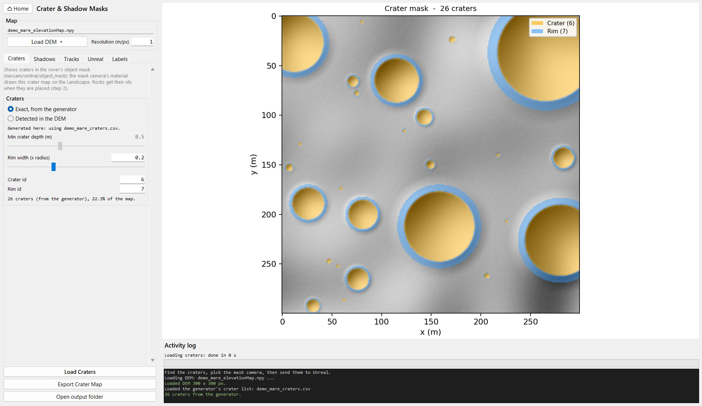

# 3. Crater and shadow masks

Shows craters and shadows in the rover's object mask, alongside the rocks.

*The front navcam and the rear camera during a drive, with their ground-truth object
masks and shadow masks (2.4x speed; [video](videos/ground_truth.mp4) at 1.2x). Ahead, the rover's own
shadow (orange) is labelled apart from the terrain's shadows; behind, the wheel
tracks it leaves are their own class in the object mask.*

## Steps

1. **Find Craters** maps them on the DEM and shows them on the map preview.
2. **Mask Camera in Unreal** picks the scene capture that renders the mask. The
   list is read from the open level, and the default is the rover's
   `Navcam_Mask`.
3. **Send Masks to Unreal**:
   - exports the crater map;
   - rebuilds `PPM_GroundTruthMask` so the Landscape shows the craters and, with
     *Stream a shadow mask feed*, the frame also carries the shadows and, with
     *Tag the rover's shadow separately*, the rover's own shadow
     ([Rover shadow](#rover-shadow));
   - sets up the chosen camera: it gets `PPM_GroundTruthMask` and the sun-only
     render shadows need, and, if its actor has an UnrealStereoCam, it becomes
     the streamed mask camera (of the navcam rig's UnrealStereoCam, when the
     actor has several).

   The rover's rear camera has a mask capture of its own, `RearCam_Mask`,
   streamed by `RearCam_Stream` (see UnrealStereoCam's
   [extra cameras](https://github.com/raulcastar/UnrealStereoCam/blob/main/docs/options.md)).
   It uses the same `PPM_GroundTruthMask`, so every send updates it too; keep
   `Navcam_Mask` as the mask camera chosen here.

   **Restore Original Mask Material** undoes the material change.

   The material, and so the crater map, is one asset for the whole project:
   a send replaces the crater map in **every** level, not only the open one.
   If levels sit on different terrains, send the masks again for a level's own
   map before recording ground truth there (rocks, the rover and wheel tracks
   are tagged per actor and are not affected).
4. **GNC Labels** shows the object-mask classes with the rock and crater ids
   chosen here, and whether the GNC simulator's copy
   (`GNC-Moon-Simulator/component_stereo_depth/config/mask_classes.json`, read
   when that repository sits next to this one) differs. **Copy** puts a complete
   `mask_classes.json` with these ids on the clipboard, to paste into the GNC
   copy (and into `config/` here to keep changed ids).

## Where the craters come from

- **Terrains generated in the studio** come with `<name>_craters.csv`, used by
  default (*Exact, from the generator*). The crater is the bowl inside the rim
  crest, at the crater radius; the generator's ejecta rim reaches 1.5 × the
  radius (rim width 0.5).
- **Other maps** are *Detected in the DEM*: starting from the closed
  depressions the rock planner treats as impassable, each crater is the circle
  fitted through its rim crest (so it covers the whole bowl even on sloping
  ground), and shallow or elongated basins are rejected. On generated terrain,
  detection sizes large craters (radius ≥ 10 px) within 3%, but makes small
  ones (5–10 px) about 40% too small: prefer the generator's list when there is
  one.

The crater map is `<name>_craterMask.png` in the map's output folder, with a
JSON beside it. It uses 4 cells per DEM cell (25 cm on a 1 m map), capped at
8192 px. Its pixel values are mask ids:

| Value | Meaning |
| --- | --- |
| `0` | Not a crater |
| `6` | Crater: ground inside the rim crest |
| `7` | Crater rim: a ring outside the crest, 0.2 × the radius wide by default |

## How the mask is drawn

The mask camera's material looks at each Landscape pixel (stencil 5), takes the
world point it shows, and reads the crater map there. So rocks and the rover
keep their own ids, and craters hidden behind terrain stay hidden. It also
works during Play In Editor, although camera changes made then last only until
it stops.

Everything lives in `/Game/GroundTruth_Masks`, one subfolder per feature:

| Asset | What it is |
| --- | --- |
| `Mask/PPM_GroundTruthMask` | Post-process material on the mask camera: object ids, crater ids on the Landscape, shadow flag bits |
| `Mask/PPM_GroundTruthMask_Backup` | That material as it was before the studio first changed it; **Restore Original Mask Material** puts it back |
| `CraterMaps/T_CraterIds_<map>` | Crater map: crater or rim id per cell |
| `RoverShadow/RT_RoverDepthFromSun` | The rover's shadow map: its depth seen from the sun |
| `Sun/MPC_Sun` | The sun's direction and disc size, for its id in the object mask |
| `WheelTracks/M_WheelTrackDecal` | The wheel-track decal material |

Assets still directly in the folder, or under their earlier names
(`PPM_ObjectMask`, `PPM_ObjectMask_Original`, `RT_SunWithoutRover`), are moved
on the next send.

GNC receives these feeds from the mask camera, all from the same frame:

| Topic | Contents |
| --- | --- |
| `navcam/central/object_mask` | Rover, landscape, rocks, craters and rims, without shadows |
| `navcam/central/shadow_mask` | Sunlight only: black in shadow (ground, rocks, rover), orange for the rover's own shadow, blue for sunlit ground, grey for sunlit rocks and the rover, black for sky |
| `navcam/central/shadow_label` | The same classes as ids (mono8), for training; see [Shadow class ids](#shadow-class-ids) |
| `navcam/central/shadow_label_mapping` | JSON legend of those ids |

The dashboard shows them as SEGMENTATION and SHADOW MASK, with legends listing
each class with its id, grouped into ground, objects and sky.

## Object mask ids

The ids are consecutive, each drawn in one fixed colour. They are defined once,
in `config/mask_classes.json` (id, name, group, colour), read by
`Terrain_Studio/unreal_link/mask_classes.py` for the mask material's palette,
the actors' stencils, the crater map and the GUI. The GNC simulator keeps a copy
of the same file (`component_stereo_depth/config/mask_classes.json`): its stereo
node publishes the classes and its dashboard draws the legends from them. Edit
both together; the file is read on every action, so an edit applies without
restarting the editor.

| Id | Class | Colour (RGB) | Comes from |
| --- | --- | --- | --- |
| 0 | `unlabeled` | 0, 0, 0 | Anything not tagged |
| 1 | `sky` | 36, 40, 96 | Nothing within 100 km of the camera |
| 2 | `rover` | 250, 194, 16 | The rover's CustomDepth stencil (its Blueprint) |
| 3 | `sun` | 28, 128, 162 | Sky within the sun's disc |
| 4 | `sun_glare` | 230, 14, 118 | Sky around the disc, out to the glare radius |
| 5 | `landscape` | 10, 96, 216 | The Landscape's stencil |
| 6 | `crater` | 124, 50, 208 | The crater map, on the Landscape |
| 7 | `crater_rim` | 86, 52, 82 | The crater map, on the Landscape |
| 8 | `wheel_track` | 64, 124, 162 | Track decals, on the Landscape |
| 9 | `boulder` | 238, 244, 242 | Rock stencil (radius ≥ `BOULDER_MIN_RADIUS_M`, 0.5 m) |
| 10 | `small_rock` | 210, 62, 6 | Rock stencil (smaller rocks) |

The lowest bit of each channel carries the shadow flags (cleared in
`object_mask`), so the colours are even. A custom stencil above 10 gets a colour
hashed from its id. Sending the masks re-tags a Landscape still on the earlier
stencil (10); rocks placed before keep theirs until **Update Mask Ids Only**.

## Shadows

Shadows come from the engine's own rendering, so they match what the cameras
see: the rover's and the rocks' shadows, crater walls, hills and slopes facing
away from the sun. The mask camera renders every surface white, lit by the sun
alone (no bounce light, no sky light, no headlights or other lights); its
colours are replaced by the mask material, so this changes nothing else. Any
surface this render leaves dark is shadow, including a patch lit only by the
rover's headlights.

### Shadow threshold

A pixel is shadow when the sun-only render shows it **just above black**
(display value 0.02 of 1): no sunlight reaches it.

- Set by `SHADOW_THRESHOLD` in
  `Terrain_Studio/unreal_commands/unreal_ground_truth.py` and written to the
  `ShadowThreshold` parameter of `PPM_GroundTruthMask` on every send.
- With the sun as the only light, a shadowed pixel renders black. A lit one
  renders at a brightness that follows the sun's angle on it, so lit ground
  gets dim, but not black, as the sun gets low. A threshold of half of full
  sunlight (0.5, used before) therefore marked most lit ground as shadow at a
  low sun, in a fine mesh following the regolith's relief: 75-93 % of the
  ground below 9° of elevation and 20-60 % at 20-30°, against about 10 % with
  0.02 at 8°.
- Surfaces facing away from the sun are shadow too (unlit), including the small
  facets of the regolith's relief at a low sun, as in the RGB image.
- Soft shadow edges are thin on the Moon (0.53° solar disc); with sharp shadows
  (`r.Shadow.Virtual.SMRT.RayCountDirectional 0`) there are none.

### Shadow class ids

`navcam/central/shadow_label` is a mono8 image the size of the mask, aligned
pixel for pixel with `image_color` and `object_mask`:

| Id | Class | Meaning |
| --- | --- | --- |
| 0 | `sky` | No surface |
| 1 | `sunlit_ground` | Landscape, crater or rim in sunlight |
| 2 | `shadowed_ground` | Landscape, crater or rim without sunlight |
| 3 | `sunlit_object` | Rock or rover in sunlight |
| 4 | `shadowed_object` | Rock or rover without sunlight, including its unlit side |
| 5 | `rover_shadow` | Ground or rock in the rover's own shadow |

The legend is also published as JSON on `shadow_label_mapping`. Store the labels
losslessly (PNG or the bag itself; JPEG would change the ids). For finer
classes, combine them with `object_mask` pixel by pixel (e.g. "boulder in
shadow").

### How the shadows travel

The mask material stores three flags in the lowest bit of each channel:
*ground* in green, *in shadow* in blue and *rover shadow* in red, changing the
mask colours by at most 1/255. The GNC stereo node (`enable_shadow_mask` in
`component_stereo_depth/config/params.yaml`) paints `shadow_mask` and
`shadow_label` from these flags and clears them from `object_mask`. One camera
therefore gives exactly aligned feeds, with no change to the UnrealStereoCam
plugin.

## Sun

With *Tag the sun's disc in the object mask* (Sun group, on by default), sky
pixels within the sun's disc get id 3 (`sun`); the rest of the sky is id 1.

- The disc follows the level's Directional Light: its direction, and its size
  from *Source Angle* (0.53°, about 4 pixels on the navcam). Terrain or rocks in
  front of the sun hide it, as in the RGB image.
- The navcam's bloom makes the sun look much bigger, so the sky around the disc,
  out to *Glare radius* (default 1.1°), gets id 4 (`sun_glare`). 1.1° matches
  the camera's saturated core (17.2 px across, against 17.4 px for disc plus
  glare, covering 91% of the saturated pixels). Half brightness reaches about
  3.5° and faint glare spikes about 6°; set a larger radius to include them, or
  0 for no ring. Like the disc, the glare is only tagged on sky.
- The light's direction reaches the material through `MPC_Sun`, which the
  [editor watcher](editor-watcher.md) keeps current, also during Play: moving
  the sun needs no new send.
- The disc is flagged red without blue, so the shadow feeds keep it as sky.

## Wheel tracks

With *Rover leaves wheel tracks* (Wheel Tracks group, on by default), each wheel
of the mask camera's actor leaves a track on the Landscape during Play: a
shallow rut with tread ribs across it, in packed-down regolith. Track pixels get
id 8 (`wheel_track`).

The decal redraws the Landscape's own regolith texture at the same place (same
tiling, desaturation and near/far blend as `Landscape_Material`, read from it on
each send), so a track keeps the ground's grain and colour:

- **Normal:** the Landscape's normal map at both tilings, on the slope under the
  track, pressed to 60% by the wheel, plus the rut and square lug imprints every
  3 cm with sloped flanks, which catch the sun like a tyre print.
- **Roughness:** the Landscape's roughness texture, 10% smoother.
- **Specular:** the Landscape's (0), so tracks do not shine.
- **Colour:** the lug imprints are 8% darker; overall about 9% darker than the
  ground beside them.

How they are laid:

- **Send Masks to Unreal** places a pool of 2000 hidden track decals (Outliner
  folder `WheelTracks`). The first time takes about two minutes; later sends
  reuse them. Save the level to keep them.
- During Play the editor watcher lays the next decal under each wheel that
  touches the Landscape, every 12 cm, once every wheel has rolled off that spot.
  About 60 m per wheel are kept, the oldest reused; tracks start afresh each
  Play. None are left on rocks or while a wheel is in the air.
- For the first 3 s of Play (`SETTLE_TIME_S` in
  `unreal_runtime/unreal_wheel_tracks.py`) the rover settles and lays no tracks.
- The rover itself is only read, never changed, while the game runs: changing a
  simulating part's properties rebuilds its physics and breaks the wheel
  constraints.
- The decal writes a tiny metallic value (0.05) that regolith never has; the
  mask material reads it to tag the track, also on craters and rims.

**Tread look** (Wheel Tracks group, with a preview):

| Setting | Choices |
| --- | --- |
| Tread pattern | Straight lugs (default), Chevron, Staggered blocks, Smooth (no tread) |
| Lug spacing | 2, 3 (default), 4 or 6 cm; all divide the 12 cm decal spacing, so the tread stays continuous |
| Tread relief | 0 (none) to 2 (deep); 1 default |
| Regolith shade | 0.5 (dark tracks) to 1 (same as the ground); 0.7 default |

**Apply Track Look** updates only the track material (also during Play).
Unticking the option and sending again removes the decals.

## Rover shadow

With *Tag the rover's shadow separately* (on by default), ground and rocks in
the rover's own shadow get id 5 (`rover_shadow`) instead of 2 or 4.

- **Send Masks to Unreal** adds a helper capture, `<actor>_RoverShadowCapture`:
  the rover's own shadow map. It renders only the rover's depth, looking along
  the sunlight (orthographic, about 2 m across, 512 × 512 into
  `RT_RoverDepthFromSun`), before the mask camera each frame: much cheaper than
  a second camera view.
- A shadowed pixel is the rover's shadow when the rover lies between it and the
  sun, so the rover's shadow wins over any other shadow on the same ground. The
  rover itself is never tagged: its unlit side stays `shadowed_object`.
- The [editor watcher](editor-watcher.md) points the shadow map at the rover
  from the sun every frame, in the level and in a running game.
- Add it in the editor, not during Play, and save the level (Ctrl+S) to keep the
  helper. Unticking the option and sending again removes it, as does **Restore
  Original Mask Material**.
- Unreal's Python cannot set a capture's show-only list in the editor, so the
  studio pastes the helper from text with the list filled in. That briefly uses
  the clipboard; its text is put back afterwards (other content, such as an
  image, is not).
