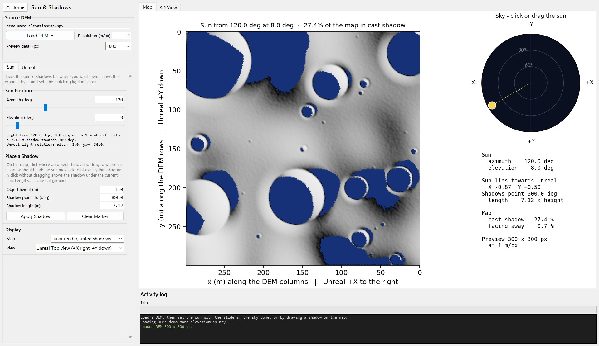
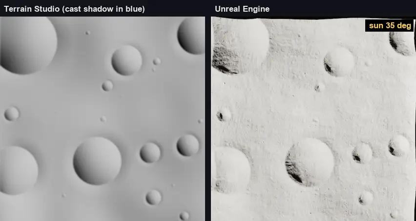

# 4. Position the sun

*The same terrain in the studio and in Unreal as the sun goes down from 35° to
3° at azimuth 120° ([video](videos/sun_studio_vs_unreal.mp4)). The studio
shows cast shadows in blue; Unreal is seen from straight above, in its Top-view
orientation.*

Places the sun so shadows fall where you want them and sets the matching light
in Unreal. The sun is set with the azimuth and elevation sliders, by clicking
the sky dome, or by drawing a shadow on the map: click where an object of a
given height stands and drag to where its shadow should end.

Azimuth is measured clockwise from the top of the DEM image: 0 points to Unreal
−Y and 90 to −X. The Landscape mirrors the DEM (columns run towards −X), so by
default the map is shown as Unreal's Top view shows it (+X right, +Y down). The
sky dome is labelled with Unreal's axes.

The map shows the terrain lit by that sun, with no sky light, so shadows are
black; cast shadows can be tinted to tell them apart from slopes facing away. A
second tab shows a lit 3D view. Shadows are cast from the DEM, which matches the
Landscape: line traces in Unreal agree with them at 97–100% of points, and every
mismatch lies on a shadow edge.

**Send Sun to Unreal** updates the light labelled `LunarSun`, or the level's
only Directional Light, and spawns `LunarSun` if there is neither. It applies
lunar settings: white light with no atmospheric reddening, a 0.53° sun disc,
movable with dynamic shadows reaching at least 200 m, and the intensity set in
the panel.

During Play In Editor only the running game changes; send the sun again after
stopping it to keep it in the level. **Read Sun from Unreal** loads the level's
current sun into the sliders.
