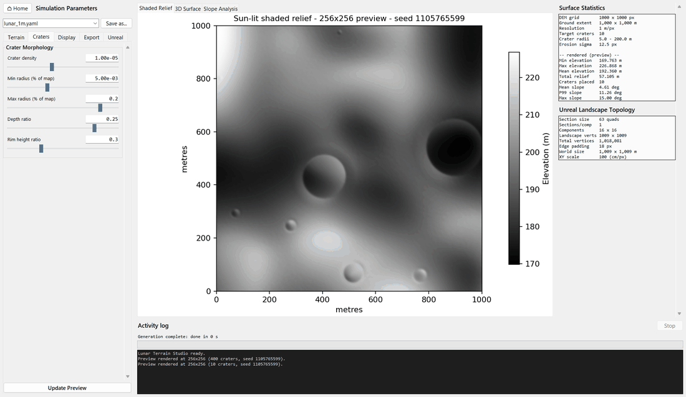
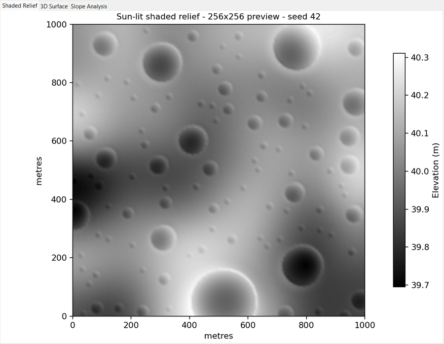
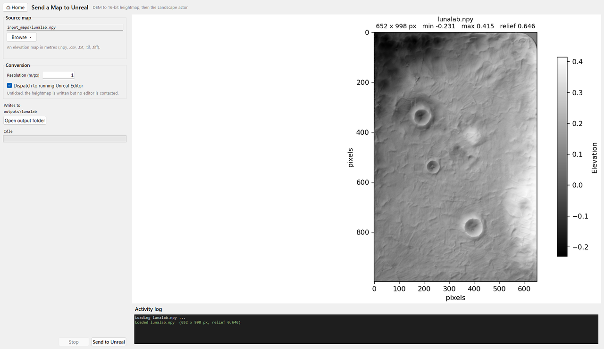
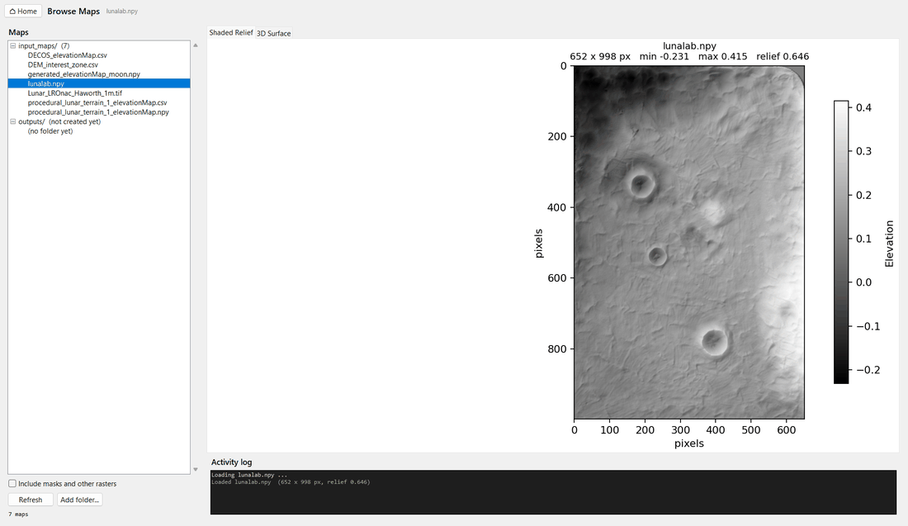

# 1. Create a terrain and send it to Unreal



- **Parameters** (left), in tabs: **Terrain** (preview, map geometry, relief,
  seed), **Craters**, **Display** (colormap and shading), **Export** (Generate
  Full Resolution) and **Unreal** (Send to Unreal). Every setting is a slider
  with a typed entry and a tooltip. Presets are the YAML files in `config/`,
  shared with the command line.
- **Preview** (centre): shaded relief, 3D surface and slope analysis, updated as
  you drag. A fixed seed reproduces a surface; a blank seed rolls a new one.

  
- **Readouts** (right): surface statistics and the resulting Unreal Landscape
  topology, which warns if the map exceeds a single Landscape's 50×50 components.

Column widths are adjustable with the drag handles.

## Outputs

**Generate Full Resolution** writes the DEM to `outputs/<name>/`; the panel
lists the exact filenames before you run.

| File | Contents |
|---|---|
| `<name>_elevationMap.npy` / `.csv` | The DEM |
| `<name>_soilMap.csv` | Soil map (interior 1, border 0) |
| `<name>_craters.csv` | Every crater placed: `id, row, col, radius_px, x_m, y_m, radius_m, depth_m, rim_height_m, ejecta_radius_m` |

The crater list is the exact ground truth that the rock planner and the crater
masks use. The elevation and soil CSVs are the maps the GNC path planner reads:
copy them to `GNC-Moon-Simulator/component_path_planner/maps/` and name them in
its `config/params.yaml`.

## Send to Unreal

**Send to Unreal**, on the **Unreal** tab, takes the generated map (or any other
you pick). It converts the map to Unreal's 16-bit `.r16` heightmap (written to
`outputs/<name>/`), spawns the Landscape in the running editor, applies the
heightmap and saves the level. Untick *Dispatch to running Unreal Editor* to
only write the files (a dialog then gives the path and the manual import
steps), or *Save the level afterwards* to leave saving to you.



Every new Landscape is set up for the simulator: it gets the project's
`/Game/Landscape/Landscape_Material`, and it is tagged for the rover's object
mask (Render CustomDepth on, stencil 5, `landscape`; see
[Object mask ids](masks.md#object-mask-ids)). If that material is missing, a
warning is logged and the engine's default stays. Both defaults are at the top
of `unreal_landscape.py`.

*Nanite Landscape* (on by default, in Send an Existing Map) renders large
Landscapes faster, but Unreal rebuilds the Nanite mesh on every save, which
freezes the editor while it saves: about 15 s more for a 1009 × 1009 Landscape
(24 s against 10 s), and longer as the Landscape grows. Untick it for quick
saves while iterating. The build also needs a lot of memory: a 2269 × 2080
Nanite Landscape once ran the editor out of memory while it held several other
Landscapes, so the activity log warns when Nanite is on for a Landscape over
2017 vertices a side. If the editor reports *Unable to
Check Out From Revision Control* on each save, revision control is switched on
without a working connection: turn it off (bottom-right *Revision Control* →
*Disable*) unless you use it.

Landscapes larger than 4097 × 4097 vertices, or an automatic import that fails,
fall back to the manual import (Landscape Mode → Manage → right-click →
Import), with the steps shown in the editor.

**Library → Send an Existing Map** is the same sender on its own, for any
elevation map already on disk. A GeoTIFF fills in *Resolution* from its own
pixel size, and its NoData cells are treated as missing (not as deep pits) in
the preview and in crops. Every view that loads a map (Send to Unreal, Rocks,
Masks, Sun) takes its resolution from the map when it records one: a GeoTIFF,
a saved crop, or a map generated here (from its crater list).

### Crop a region of a large map

Real DEMs are often far larger than one Landscape: an LRO NAC strip is about
12 000 px a side, past both the automatic import (4097 vertices) and, at worst,
the 50 × 50 components a Landscape can hold. To bring in only part of it, tick
**Send only a region of the map** in the *Crop* group:

- A rectangle appears on the map: drag to draw a new one, drag inside it to move
  it, and drag its handles to resize it. *X*, *Y*, *Width* and *Height* show it
  in the map's pixels and can be typed instead; the map's axes use the same
  pixels. For a map too large to import automatically, it starts as the largest
  square that is, centred.
- **Snap to a Landscape size** shrinks the region to a size Unreal builds
  exactly (a whole number of components of one size, in both directions), so no
  edge is padded.
- The read-out gives the region in pixels and metres, and the Landscape it
  makes (components, quads, sections, vertices, padding). It turns amber when
  Unreal would need the manual import or cannot hold the region at all.

**Send to Unreal** then saves the region as its own map and sends it; **Save
crop** only saves it. Either way the crop is written to
`outputs/<map>_crop_x<X>_y<Y>_<W>x<H>/` as a `.npy`, with a `_crop.json` that
records its source map, its position and its resolution (which a `.npy` cannot
carry). The crop becomes the current map, so the rock planner, the masks and
the sun work on the same region as the Landscape, and its later files land in
the same folder.

## Browse maps



**Library → Browse Maps** lists every map in `input_maps/` and `outputs/`;
selecting one renders it as a shaded relief or a rotatable 3D surface, and makes
it the current map for the other steps. Soil, class and rock rasters are hidden,
since they share extensions but are not heights.

## Parameters

| Key | Meaning |
| --- | --- |
| `ROWS`, `COLS` | DEM size in pixels |
| `RESOLUTION_M_PER_PX` | Ground metres per pixel; sets the Unreal XY scale |
| `BASE_ELEVATION` | Datum in metres; kept above zero, as zero is treated as no-data |
| `RANDOM_SEED` | `null` for a new surface each run, or an integer to reproduce one |
| `MACRO_ELEVATION_MIN` / `MAX` | Range for the total hill relief |
| `EROSION_BLUR_DIVISOR` | Smoothing sigma is `max(rows, cols) / divisor`; lower is smoother |
| `MICRO_ROUGHNESS` | High-frequency noise; prevents 16-bit terracing in Unreal |
| `CRATER_DENSITY` | Craters per pixel of area |
| `CRATER_MIN_RADIUS_PCT` / `MAX` | Crater radii as a fraction of the largest map dimension |
| `CRATER_DEPTH_RATIO` | Bowl depth relative to radius (lunar craters are near 0.2) |
| `CRATER_RIM_HEIGHT_RATIO` | Rim height relative to bowl depth |
| `EXPORT_CSV`, `EXPORT_NPY` | Output formats |

Craters never overlap; at high densities fewer than the target may fit, which
the studio reports. Large maps build their macro terrain on a 1024 px grid and
upsample it, keeping a 10000 × 10000 map to seconds rather than tens of minutes.

## Command line

Generate a terrain without the GUI:

```sh
cd Terrain_Studio/generator
python generate_cli.py -c ../../config/lunar_1m.yaml -n my_terrain --no-preview
```

| Flag | Meaning |
| --- | --- |
| `-c, --config` | YAML preset (default `config/settings.yaml`; created with defaults if missing) |
| `-o, --output-dir` | Destination (default `<repo>/outputs`) |
| `-n, --name` | Base filename |
| `--no-preview` | Skip the Matplotlib window |

Convert a DEM to a heightmap and send it to Unreal:

```sh
cd Terrain_Studio/unreal_link
python send_terrain.py <map> [output_dir] [resolution_m_per_px]
```
