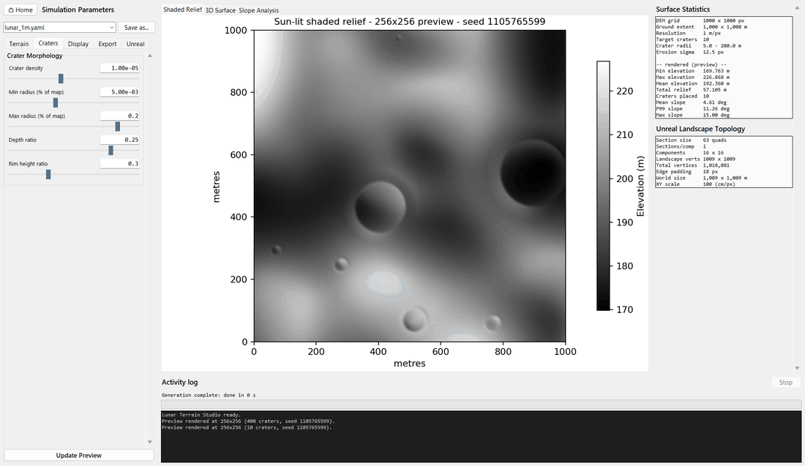
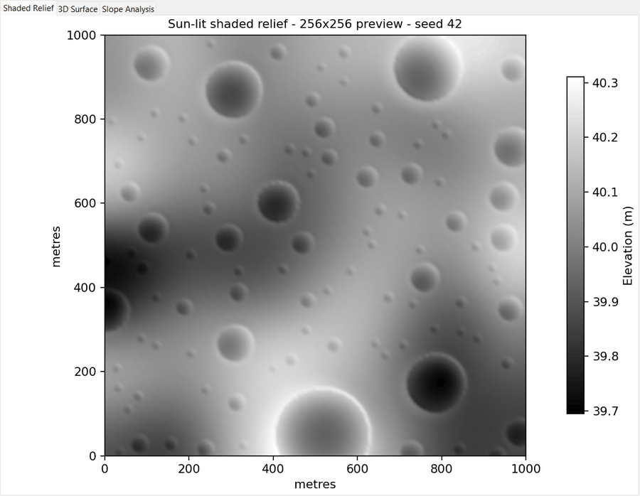
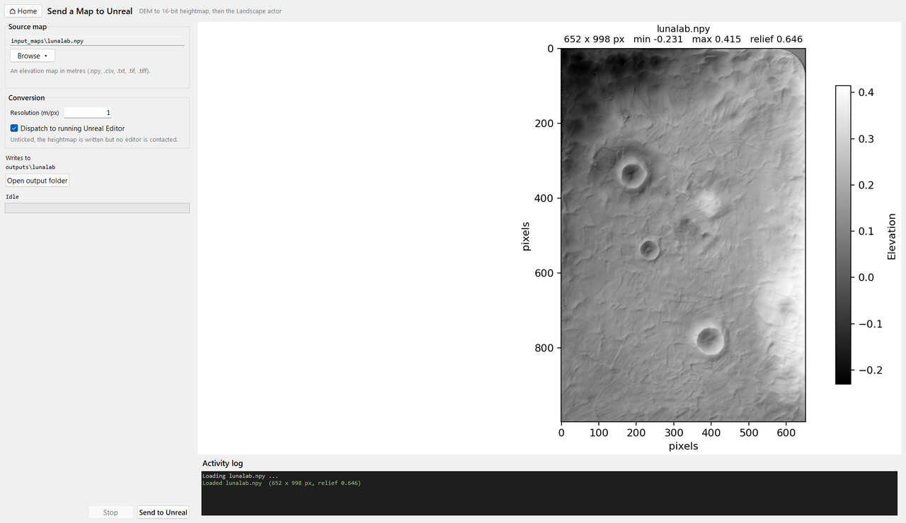

# 1. Create a terrain and send it to Unreal



- **Parameters** (left), in tabs: **Terrain** (preview, map geometry, relief,
  seed), **Craters**, **Display** (colormap and shading), **Export** (Generate
  Full Resolution) and **Unreal** (Send to Unreal). Every setting is a slider
  with a typed entry and a tooltip. Presets are the YAML files in `config/`,
  shared with the command line.
- **Preview** (centre): shaded relief, 3D surface and slope analysis, updated as
  you drag. A fixed seed reproduces a surface; a blank seed rolls a new one.

  
- **Readouts** (right): surface statistics and the resulting Unreal Landscape
  topology, which warns if the map exceeds a single Landscape's 50×50 components.

Column widths are adjustable with the drag handles.

## Outputs

**Generate Full Resolution** writes the DEM to `outputs/<name>/`; the panel
lists the exact filenames before you run.

| File | Contents |
|---|---|
| `<name>_elevationMap.npy` / `.csv` | The DEM |
| `<name>_soilMap.csv` | Soil map (interior 1, border 0) |
| `<name>_craters.csv` | Every crater placed: `id, row, col, radius_px, x_m, y_m, radius_m, depth_m, rim_height_m, ejecta_radius_m` |

The crater list is the exact ground truth that the rock planner and the crater
masks use. The elevation and soil CSVs are the maps the GNC path planner reads:
copy them to `GNC-Moon-Simulator/component_path_planner/maps/` and name them in
its `config/params.yaml`.

## Send to Unreal

**Send to Unreal**, on the **Unreal** tab, takes the generated map (or any other
you pick). It converts the map to Unreal's 16-bit `.r16` heightmap (written to
`outputs/<name>/`), spawns the Landscape in the running editor, applies the
heightmap and saves the level. Untick *Dispatch to running Unreal Editor* to
only write the files (a dialog then gives the path and the manual import
steps), or *Save the level afterwards* to leave saving to you.



Every new Landscape is set up for the simulator: it gets the project's
`/Game/Landscape/Landscape_Material`, and it is tagged for the rover's object
mask (Render CustomDepth on, stencil 5, `landscape`; see
[Object mask ids](masks.md#object-mask-ids)). If that material is missing, a
warning is logged and the engine's default stays. Both defaults are at the top
of `unreal_landscape.py`.

Landscapes larger than 4097 × 4097 vertices, or an automatic import that fails,
fall back to the manual import (Landscape Mode → Manage → right-click →
Import), with the steps shown in the editor.

**Library → Send an Existing Map** is the same sender on its own, for any
elevation map already on disk.

## Parameters

| Key | Meaning |
| --- | --- |
| `ROWS`, `COLS` | DEM size in pixels |
| `RESOLUTION_M_PER_PX` | Ground metres per pixel; sets the Unreal XY scale |
| `BASE_ELEVATION` | Datum in metres; kept above zero, as zero is treated as no-data |
| `RANDOM_SEED` | `null` for a new surface each run, or an integer to reproduce one |
| `MACRO_ELEVATION_MIN` / `MAX` | Range for the total hill relief |
| `EROSION_BLUR_DIVISOR` | Smoothing sigma is `max(rows, cols) / divisor`; lower is smoother |
| `MICRO_ROUGHNESS` | High-frequency noise; prevents 16-bit terracing in Unreal |
| `CRATER_DENSITY` | Craters per pixel of area |
| `CRATER_MIN_RADIUS_PCT` / `MAX` | Crater radii as a fraction of the largest map dimension |
| `CRATER_DEPTH_RATIO` | Bowl depth relative to radius (lunar craters are near 0.2) |
| `CRATER_RIM_HEIGHT_RATIO` | Rim height relative to bowl depth |
| `EXPORT_CSV`, `EXPORT_NPY` | Output formats |

Craters never overlap; at high densities fewer than the target may fit, which
the studio reports. Large maps build their macro terrain on a 1024 px grid and
upsample it, keeping a 10000 × 10000 map to seconds rather than tens of minutes.

## Command line

Generate a terrain without the GUI:

```sh
cd Terrain_Studio/generator
python generate_cli.py -c ../../config/lunar_1m.yaml -n my_terrain --no-preview
```

| Flag | Meaning |
| --- | --- |
| `-c, --config` | YAML preset (default `config/settings.yaml`; created with defaults if missing) |
| `-o, --output-dir` | Destination (default `<repo>/outputs`) |
| `-n, --name` | Base filename |
| `--no-preview` | Skip the Matplotlib window |

Convert a DEM to a heightmap and send it to Unreal:

```sh
cd Terrain_Studio/unreal_link
python send_terrain.py <map> [output_dir] [resolution_m_per_px]
```
